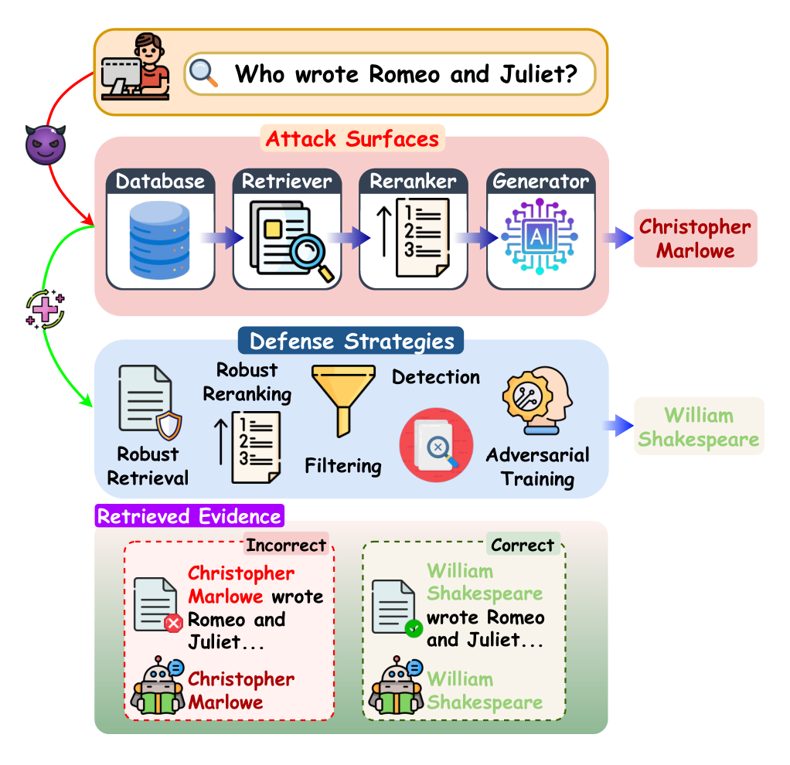
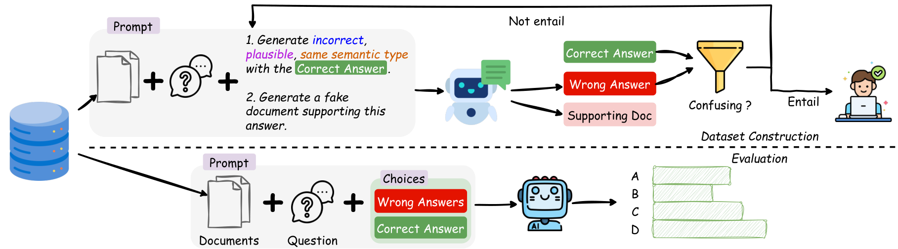
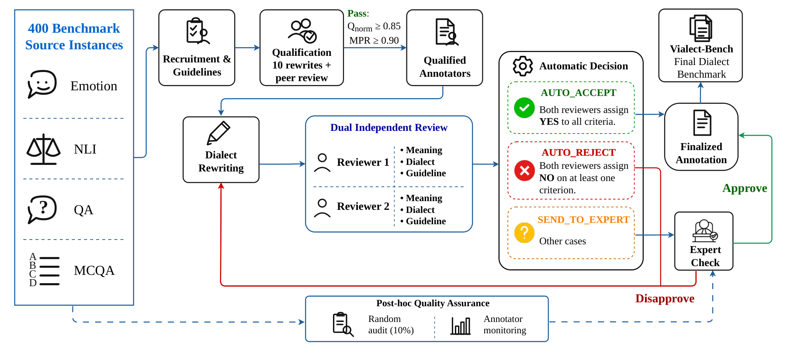
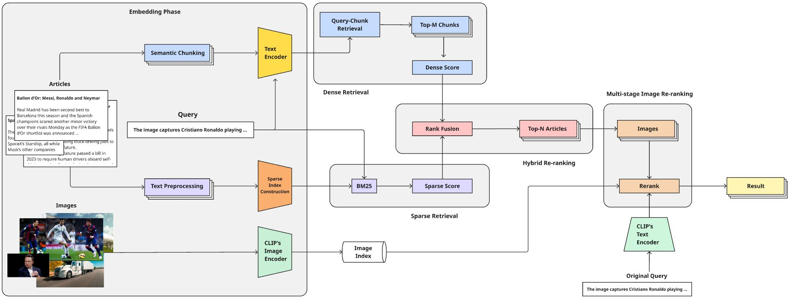

# Portfolio project copy

Prepared from CV_VinCAIR.pdf (September 2026), the linked papers, and original project repositories.

Titles and abstracts below are newly written portfolio copy. Formal paper titles are preserved separately. Review and publication labels follow the supplied CV; under-review work is not described as accepted.

## Profile

Tran Ta Quang Minh (Trần Tạ Quang Minh) is an undergraduate AI researcher at the University of Science, VNU-HCM. His research focuses on trustworthy AI, retrieval-augmented generation, uncertainty quantification, and Vietnamese language understanding. He also develops applied computer-vision systems and mentors student projects at SEAS.

## Retrieved But Not Reliable

**Subtitle:** Mapping attacks and defenses across the RAG pipeline

**Role:** First author  
**Status:** Findings of EMNLP 2026

**Abstract**

Retrieval can ground an answer in external knowledge while also exposing new ways to manipulate it. This survey organizes RAG attacks by their effects on accuracy, privacy, and fairness, and maps defenses to retrieval, reranking, generation, and traceback. By bringing threat models, evaluation benchmarks, and explainability methods into one framework, the work helps researchers identify vulnerable stages and assess defenses across the full retrieval-augmented pipeline.

**Contribution / scope**

Conducted a pipeline-aware survey of RAG robustness and security, organizing threat models, attacks, defenses, benchmarks, and explainability methods.

**Formal paper title:** Retrieved But Not Reliable: A Survey on Attacks, and Defenses in Retrieval-Augmented Generation

**Figure credit:** Figure 1 · Original overview from Tran et al., Retrieved But Not Reliable, arXiv:2608.24977v2.

[Original figure source](https://arxiv.org/html/2608.24977v2#S1.F1)

- [Paper](https://arxiv.org/abs/2608.24977)
- [Code & reading list](https://github.com/coutMinh/A-Survey-on-RAG-Robustness)

## URAG

**Subtitle:** Measuring uncertainty in retrieval-augmented LLMs

**Role:** Co-author  
**Status:** Under review · NeurIPS 2026

**Abstract**

A correct answer alone does not explain whether a retrieval-augmented model is reliable. URAG evaluates accuracy alongside uncertainty across eight datasets spanning five domains. Its construction pipeline turns open-ended tasks into multiple-choice questions with challenging distractors, enabling conformal prediction to measure uncertainty through prediction sets. The benchmark examines how retrieval noise, retrieval depth, and a model's existing knowledge affect confidence, revealing settings where additional evidence can still lead to overconfident errors.

**Contribution / scope**

Contributed to the benchmark and developed a standardized pipeline for converting open-ended RAG tasks into multiple-choice questions for uncertainty assessment.

**Formal paper title:** URAG: A Benchmark for Uncertainty Quantification in Retrieval-Augmented Large Language Models

**Figure credit:** Figure 2 · Original dataset construction and evaluation pipeline from Nguyen et al., URAG, arXiv:2603.19281v1.

[Original figure source](https://arxiv.org/html/2603.19281v1#S3.F2)

- [Paper](https://arxiv.org/abs/2603.19281)
- [Code](https://github.com/phuvinhnguyen/URAG)

## VialectBench

**Subtitle:** Testing LLMs across Vietnamese dialects

**Role:** Co-first author  
**Status:** Under review · AAAI 2027

**Abstract**

Meaning can stay the same even when regional language changes. VialectBench tests whether LLM predictions remain stable across six Vietnamese dialect groups, using 400 standard-language instances and 2,400 human-written rewrites across four language-understanding tasks. Evaluation of ten instruction-tuned models measures performance loss, prediction inconsistency, and harmful answer flips. The study shows that strong results on standard Vietnamese can conceal failures on regional variants, motivating more representative evaluation of Vietnamese language technologies.

**Contribution / scope**

Introduced VialectBench and evaluated instruction-tuned LLMs for dialect-induced performance degradation, inconsistent predictions, and harmful answer flips.

**Formal paper title:** How Robust Are LLMs to Vietnamese Dialects?

**Figure credit:** Figure 2 · Original annotation and quality-assurance pipeline from Tran et al., How Robust Are LLMs to Vietnamese Dialects?, arXiv:2608.10414v1.

[Original figure source](https://arxiv.org/html/2608.10414v1#S3.F2)

- [Paper](https://arxiv.org/abs/2608.10414)

## EVENTA

**Subtitle:** Finding images through the events they capture

**Role:** Team project  
**Status:** Second prize · EVENTA

**Abstract**

Event descriptions often require more context than a visual match alone can provide. This system combines OpenCLIP image-text embeddings with Nomic semantic retrieval and BM25 lexical search. Reciprocal Rank Fusion merges the retrieval signals, while semantic chunking and multiple reranking stages refine article and image relevance. Developed for the EVENTA challenge, the project received second prize and the team presented its approach at an ACM Multimedia workshop.

**Contribution / scope**

Engineered a two-phase retrieval system with offline embeddings and semantic chunking, followed by online dense–sparse fusion and multi-stage reranking.

**Formal paper title:** A Hybrid Dense-Sparse Multi-Stage Re-ranking Framework for Event-Based Image Retrieval

**Figure credit:** Figure 2 · Original pipeline from the 23Trinitrotoluen team manuscript linked by the EVENTA 2025 organizers.

[Original figure source](https://drive.google.com/file/d/1z1emGFeWblzfZNHfj7KFqWS6QIZnkWvt/view)

- [Code](https://github.com/coutMinh/EVENT-Event-Based-Image-Retrieval)
- [Manuscript](https://drive.google.com/file/d/1z1emGFeWblzfZNHfj7KFqWS6QIZnkWvt/view)
- [Challenge](https://ltnghia.github.io/eventa/eventa-2025)

## AI Assistant Glasses

**Subtitle:** Anticipating hazards for accessible mobility

**Role:** Team project  
**Status:** Winner · HCMUS × Bosch

**Abstract**

Assistive systems need to recognize how a scene may change as well as what it contains. This smart-glasses project combines audio and visual information to provide danger alerts for visually impaired users. An LSTM component predicts future states of moving objects, supporting alerts about evolving hazards. The project won the HCMUS × Bosch AI Innovation Competition 2024 and explores the use of computer vision and temporal modeling for accessible mobility.

**Contribution / scope**

Built multimodal danger-alert functionality and implemented an LSTM to predict future states of moving objects.

**Image:** No verified project figure is available in the supplied materials or public repository.

- [Code](https://github.com/coutMinh/AII_2024)

## Flood Forecasting for the Long Dai River

**Subtitle:** Hydrologic machine learning for Central Vietnam

**Role:** Project mentor · SEAS  
**Status:** Mentored student project

**Abstract**

Flood forecasting connects machine learning with a pressing local challenge in Central Vietnam. As a SEAS project mentor, I guided students developing a prototype for forecasting discharge in the Long Dai River up to seven days ahead. The project used filtered U.S. CAMELS hydrologic data and Open-Meteo inputs, with comparison against Google Flood Hub. Mentorship focused on connecting data selection and model development to the practical challenges of applying a forecasting system in Vietnam.

**Contribution / scope**

Mentored the student team's project design and development as part of Summer in Engineering and Applied Sciences. This is a student prototype; the CV does not report operational deployment or validated forecast accuracy.

**Image:** The SEAS repository has no original project figure. Add a team-approved pipeline, forecast plot, or presentation thumbnail when available.

- [Student project](https://github.com/SEAS-CVN/SEAS-Flood-Prediction)

## Local Fish Recognition at the Edge

**Subtitle:** Computer vision for Dong Hoi's marine species

**Role:** Project mentor · SEAS  
**Status:** Mentored student project

**Abstract**

Recognizing local fish species can support marine biodiversity education and ecosystem monitoring. At SEAS, I mentored a student team developing a computer-vision system for fish native to Dong Hoi, Quang Binh. Using FishNet as a data resource, the project explored efficient classification and edge-deployment techniques for resource-constrained hardware. Students connected dataset preparation and model development with the practical constraints of real-time recognition in a locally relevant application.

**Contribution / scope**

Mentored the student team's design of an edge-oriented fish identification application. Real-time operation and hardware deployment are project objectives; the public repository does not report measured speed or deployment results.

**Image:** The SEAS repository has no original project figure. Add the team's architecture diagram or demonstration thumbnail when available.

- [Student project](https://github.com/SEAS-CVN/fast-fish-identification)

## Additional project drafts

These entries use only details documented in the CV. Expand them when team materials are available.

### Lifelog Retrieval App

**Subtitle:** Searching everyday moments in visual archives

**Status:** Finalist · HCMC AI Challenge 2024

A visual retrieval application for finding relevant moments in lifelog collections. Developed as a team project for the Ho Chi Minh City AI Challenge 2024, where the team reached the final round.

[Project](https://github.com/coutMinh/Events-retrieval-AIC_2024-)

### Real-time Monitoring Surveillance System

**Subtitle:** Computer vision for live monitoring

**Status:** Finalist · SOICT Hackathon 2024

A computer-vision project exploring real-time surveillance and monitoring. The team reached the final round of the SOICT Hackathon 2024.

[Project](https://github.com/coutMinh/surveillance_cam)

### AquaSafe

**Subtitle:** A Data4Life hackathon prototype

**Status:** Honor Prize · Data4Life 2025

An applied team project developed for Data4Life Hack for Growth 2025 and recognized with an Honor Prize. A public demonstration is available below.

[Project](https://demo-aqua-safe.vercel.app/)

## Work in progress

**When Unlearning Hurts: Adversarial Forgetting in Graph Neural Networks** — Investigating whether adversarial manipulation of machine-unlearning procedures can cause persistent degradation across sequential graph-learning tasks. Ongoing research; no results or public paper are claimed.

**Adversarial Attacks on Video-Editing Models** — Investigating adversarial vulnerabilities in video-editing models with Thanh Le. Ongoing research; the supplied CV does not provide methods or results.

## Asset provenance and editorial notes

- URAG: original Figure 2 from arXiv:2603.19281v1, served with the paper HTML.
- RAG robustness survey: original Figure 1 from arXiv:2608.24977v2, served with the paper HTML.
- VialectBench: original Figure 2 from arXiv:2608.10414v1, served with the paper HTML.
- EVENTA: original embedded Figure 2 extracted from page 3 of the 23Trinitrotoluen team manuscript linked by the official EVENTA 2025 challenge page. The public manuscript is anonymized. Association with this project and the award are supported by the CV; formal author names are not inferred.
- Figures are reproduced as source assets, without AI generation or content alteration. The original authors retain their rights; source links accompany the website figures.
- Portrait: the public SEAS staff profile, https://seas-cvn.com/staff/tran-ta-quang-minh-2026. No synthetic portrait is used.
- Both SEAS entries describe mentored student work. No original project figure is present in either repository. These entries use text rather than an unrelated illustration or a diagram from the FishNet dataset paper.
- Flood forecasts are described as a prototype, without claims of operational warning capability or measured accuracy. Real-time fish recognition and edge deployment remain project objectives unless project measurements are supplied.
- Design references supplied in web.md: al-folio, Jon Barron, and academic-homepage. This is an original static implementation inspired by their academic structure, with no template code copied.
